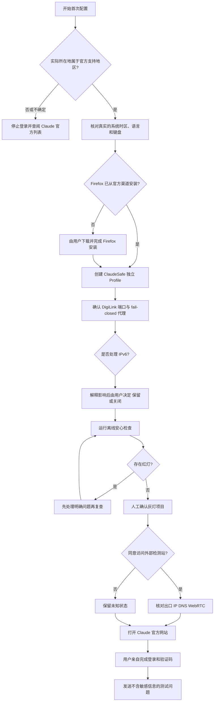

# Claude 首次安心使用流程

本流程面向在 Windows 和 Firefox 中使用 Claude 网页版的人。它帮助减少误配和不必要的数据暴露，但不保证账号结果，也不能代替 Claude 的现行条款与官方支持地区说明。

## 流程图



## 逐步说明

### 1. 先确认使用资格

查看 [Claude 官方维护的支持地区列表](https://support.claude.com/en/articles/8461763-where-can-i-access-claude)，以实际情况为准。不要用虚假位置、账单地址或身份资料制造一致性；不确定时停止登录。

### 2. 核对设备环境

检查 Windows 的时区、显示语言、输入语言和键盘布局是否符合真实使用需要。此步骤是发现旧配置或混用，不是把电脑伪装成某个地区。

### 3. 安装 Firefox

只从 [Mozilla 官方网站](https://www.mozilla.org/firefox/windows/) 或 Microsoft Store 获取 Firefox。安装由用户亲自确认。skill 不下载来历不明的安装包，也不绕过系统安全提示。

### 4. 创建 ClaudeSafe Profile

关闭专用 Firefox 窗口，在 skill 的 `claude-safety-check` 目录中运行：

```powershell
powershell -NoProfile -ExecutionPolicy Bypass -File scripts/Install-ClaudeFirefox.ps1 -ProxyPort 7892
```

该脚本创建独立 Profile 和 `Claude 安心使用` 快捷方式。它关闭该 Profile 的网页定位、WebRTC、摄像头、麦克风和通知默认权限，并固定使用指定的本地代理端口。它不会安装 Firefox，也不会登录 Claude。

### 5. 核对 DigiLink 与断线保护

先确认 DigiLink 的实际本地端口；默认示例是 `7892`。端口不一致时重新运行配置脚本并传入正确端口。

配置存在、本地端口正在监听、以及真正断线后无法联网，是三个不同事实。断线测试必须先关闭 Claude，再用普通测试网页执行。不要在 Claude 正在生成内容时断开网络。

本版本不会自动结束 Firefox 进程；是否断线后停止联网需要实际验证。固定代理仅约束该 Profile 的相关请求，不能据此宣称整机或所有后台流量都受保护。

### 6. 决定是否关闭 IPv6

不要自动关闭整个 Windows 的 IPv6。先判断所用网络是否完整支持 IPv6、IPv6 是否经过预期出口，以及 DNS/WebRTC 是否可能绕行。只有在用户理解副作用并明确同意后，才修改 DigiLink 或网络适配器设置。

### 7. 运行安心灯

运行 `scripts/Show-ClaudeSafetyDashboard.ps1`。红灯是明确需要处理的项目；灰灯表示未知、人工未确认或不适用。网页用户的 Claude Code 灰灯通常是不适用，不妨碍网页登录。

### 8. 外部风险检测

公网出口、DNS 泄漏和 WebRTC 检测会向检测网站发起请求，因此不属于默认离线检查。仅在用户同意后打开可信检测页。单个网站的 IP 风险分数不是 Claude 官方结论，也不能保证账号结果。

### 9. 登录 Claude

只打开 `https://claude.ai/`。密码、Google 登录、邮件链接、验证码、CAPTCHA、年龄确认和付款信息均由用户亲自操作。助手不得读取、记录或代填这些信息。

### 10. 第一次测试

先发送无个人、财务、医疗、工作机密或账号信息的问题，例如：

> 请用三句话解释浏览器 Profile 的作用，不要推断我的设备信息。

上传文件、启用连接器或授权外部服务前，先明确哪些内容会被 Claude 接收。

## 日常顺序

1. 先启动并确认需要的网络环境。
2. 查看安心灯；先处理红灯，理解灰灯。
3. 从 `Claude 安心使用` 快捷方式打开专用 Firefox。
4. 只输入确实准备交给 Claude 的内容。
5. 用完先关闭 Claude 标签页和专用 Firefox，再改变网络连接。
6. Firefox、Windows、DigiLink 或防火墙更新后重新检查。

